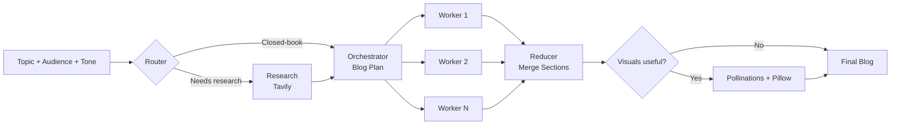

<!-- <div align="center"> -->

# ⚡ BlogBolt AI : Topic In, Blog Out.


An AI-powered blog writing workspace that **researches, plans, writes, and illustrates** complete Markdown blogs, built with Streamlit and LangGraph.


· [Features](#-features) · [How It Works](#-how-it-works) · [Quick Start](#-quick-start) · [Troubleshooting](#-troubleshooting)

<!-- </div> -->

---

## 📖 Overview

Writing a good technical blog means researching, outlining, drafting, and creating visuals. BlogBolt AI automates that entire pipeline. Enter a topic, pick the audience and tone, and a multi-stage LangGraph workflow produces a publish-ready article with sources and AI-generated diagrams.


## ✨ Features

**Generation**
- 🧠 Structured blog planning and writing with **Google Gemini**
- 🔀 Smart routing: the app decides if a topic is *closed-book*, *hybrid*, or needs *current information*
- 🌐 Optional web research with **Tavily**, with sources included in the output
- ⚙️ Parallel section writing through LangGraph workers, merged by a reducer

**Visuals**
- 🎨 AI-generated technical images via **Pollinations**
- 🔤 Exact text labels on images using **Pillow**, so no garbled AI text

**Workspace**
- 📊 Live workflow progress and event logs
- 🗂️ Tabs for Article Preview, Markdown Source, Plan, Evidence, Images, and Logs
- 🕘 Recent blogs in the sidebar
- 📥 Export as `.md` or as a `.zip` bundle (blog + images)

## 🔄 How It Works



1. **Input**: enter a topic, target audience, and tone.
2. **Route**: the router decides whether current web research is needed.
3. **Research**: Tavily gathers evidence when required.
4. **Plan**: Gemini creates a structured outline.
5. **Write**: workers generate individual sections.
6. **Merge**: the reducer assembles the full Markdown article.
7. **Illustrate**: if visuals help, Pollinations generates art and Pillow adds exact labels.
8. **Deliver**: article, sources, images, and logs appear in the workspace.

## 🛠️ Tech Stack

| Layer | Technology |
| --- | --- |
| Language | Python 3.10+ |
| UI | Streamlit |
| Orchestration | LangGraph, LangChain |
| LLM | Google Gemini |
| Web research | Tavily Search |
| Image generation | Pollinations |
| Image processing | Pillow |
| Data / validation | Pydantic, Pandas |

## 📁 Project Structure

```text
Blog_App/
├── backend.py          # LangGraph workflow and AI generation logic
├── frontend.py         # Streamlit application UI
├── requirements.txt    # Python dependencies
├── images/             # Generated and saved blog visuals
├── *.md                # Generated blog files
└── .env                # Local API keys (never commit this file)
```

## 🚀 Quick Start

### Prerequisites

- Python **3.10+**
- [Google AI API key](https://aistudio.google.com/app/apikey) (required)
- [Tavily API key](https://tavily.com) (optional, for web research)
- Pollinations API key (required for image generation)

### Installation

```bash
# 1. Clone the repository
git clone https://github.com/<your-username>/<your-repository>.git
cd Blog_App

# 2. Create a virtual environment
python -m venv .venv

# 3. Activate it
#    Windows PowerShell:
.\.venv\Scripts\Activate.ps1
#    macOS / Linux:
source .venv/bin/activate

# 4. Install dependencies
pip install -r requirements.txt
```

### Configuration

Create a `.env` file in the project root:

```env
GOOGLE_API_KEY=your_google_api_key
TAVILY_API_KEY=your_tavily_api_key
POLLINATIONS_API_KEY=your_pollinations_api_key
```

| Variable | Required | Used for |
| --- | :---: | --- |
| `GOOGLE_API_KEY` | ✅ | Gemini-powered planning and writing |
| `TAVILY_API_KEY` | ➖ Optional | Web research (skipped if missing) |
| `POLLINATIONS_API_KEY` | ✅ for images | AI image generation |

> ⚠️ **Never commit your `.env` file.** Make sure `.env` is listed in `.gitignore`.

### Run

```bash
streamlit run frontend.py
```

Open [http://localhost:8501](http://localhost:8501) if the browser doesn't launch automatically.

## 💡 Example

**Input**

| Field | Value |
| --- | --- |
| Topic | How Transformers Understand Text: Tokens, Embeddings, and Self-Attention Explained |
| Audience | Beginners |
| Tone | Friendly and clear |

**Output**: a complete Markdown article with sections, diagrams, and cited sources, saved as a `.md` file plus an `images/` folder, ready to publish on your blog, Medium, or Dev.to.

## 📦 Output

- Blog Markdown files are saved in the project root.
- Generated images are saved in `images/`.
- The UI provides **Markdown** and **ZIP** download buttons.

## 🧯 Troubleshooting

<details>
<summary><b>ModuleNotFoundError</b></summary>

Make sure the virtual environment is active and dependencies are installed:

```bash
pip install -r requirements.txt
```
</details>

<details>
<summary><b>API key errors</b></summary>

Confirm `.env` is in the same directory as `backend.py` and contains valid keys. Restart Streamlit after changing environment variables.
</details>

<details>
<summary><b>Images are not generated</b></summary>

Check that `POLLINATIONS_API_KEY` is set and that the `images/` directory is writable.
</details>

<details>
<summary><b>No research or sources in the output</b></summary>

If `TAVILY_API_KEY` is missing, the research step is skipped. Add the key and restart the app.
</details>

## 🗺️ Roadmap

- [ ] Multi-language blog generation (Hindi / Hinglish)
- [ ] SEO score and meta description generator
- [ ] One-click publishing to Medium / Dev.to / Hashnode
- [ ] Support for additional LLM providers
- [ ] Docker support and cloud deployment guide

## 🔒 Security

- Never commit `.env` or any API key.
- Use environment variables or a secrets manager in production.
- Review generated content and citations before publishing.

## 🤝 Contributing

Contributions are welcome!

1. Fork the repository
2. Create a feature branch: `git checkout -b feature/your-feature`
3. Commit your changes: `git commit -m "Add your feature"`
4. Push the branch: `git push origin feature/your-feature`
5. Open a Pull Request

## 📄 License

Distributed under the MIT License. See `LICENSE` for details.
*(Replace with the license that matches your intended use.)*

## 🙌 Acknowledgements

[Streamlit](https://streamlit.io) · [LangGraph](https://github.com/langchain-ai/langgraph) · [LangChain](https://www.langchain.com) · [Google Gemini](https://ai.google.dev) · [Tavily](https://tavily.com) · [Pollinations](https://pollinations.ai) · [Pillow](https://python-pillow.org)

---

<div align="center">

Built by **[Sumit Jaiswal](https://github.com/Sumitjaiswal9334)** · If you like this project, give it a ⭐

</div>